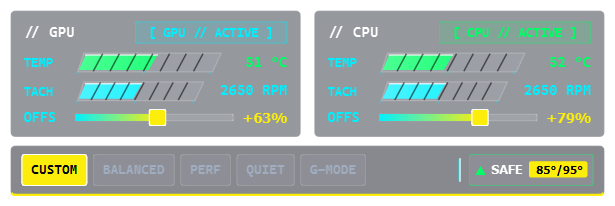

# Thermal Control Center (TCC) — Dell G-Series & Alienware Edition

[](https://microsoft.com/windows)
[](LICENSE)
[](https://pyside.org)
[](https://microsoft.com/windows)
[]()
[](https://github.com/morshedmilton/tcc-g15/releases)
[]()

A high-performance, liquid-efficient, open-source replacement for Alienware Command Center (AWCC). Engineered specifically for Dell G-series and Alienware gaming laptops with **true Windows 11 DWM Acrylic frosted glass**, a **futuristic Cyberpunk telemetry HUD**, and direct hardware-level thermal management.

---

> ### 📜 Attribution & Open Source Heritage
> This project is an independent evolution of **[tcc-g15](https://github.com/AlexIII/tcc-g15)** originally created by **[AlexIII](https://github.com/AlexIII)**.  
> We express our immense gratitude to AlexIII for the pioneering research, reverse engineering of Dell's WMI ACPI thermal interfaces, and initial implementation.
>
> In accordance with the **GNU General Public License v3.0**, this project is published as a fully open-source, independent tool providing active maintenance, Dell G15 5530 USTT firmware profiles, direct NVIDIA NVML driver telemetry, detached safety watchdogs, smart battery automation, and a modern liquid glass interface.
> - **Original Upstream:** [AlexIII/tcc-g15](https://github.com/AlexIII/tcc-g15) (Copyright © 2022–2025 AlexIII)
> - **Fork & Current Maintenance:** [morshedmilton/tcc-g15](https://github.com/morshedmilton/tcc-g15) (Copyright © 2026 Md. Morshed Milton and contributors)
> - **License:** GNU General Public License v3.0 (GPL-3.0)

---

## 📸 Interface Preview


*Figure: Futuristic Cyberpunk HUD with 25° skewed tachometer gauges, vector hardware chip icons, and real-time Windows 11 DWM Acrylic frosted glass translucency.*

> **Liquid Glass in Action:** When running on your desktop, the window background is a translucent frosted glass pane that dynamically blurs and shifts with whatever wallpaper, IDE, or game is beneath it.

---

## ⚖️ Feature Comparison: tcc-g15 Fork vs. Upstream vs. Dell AWCC

| Feature | tcc-g15 (Morshed Milton Fork) | AlexIII Upstream | Dell AWCC (Official) |
|---|---|---|---|
| **Thermal Modes** | **5 Full Modes:** Balanced (`0xA0`), Performance (`0xA1`), Quiet (`0xA3`), G-Mode (`0xAB`), Custom (`0x0`) | 2–3 Basic Modes (Custom, Balanced, partial G-Mode) | OEM Profiles (frequently reset after sleep/reboot) |
| **GPU Telemetry** | **Direct NVIDIA NVML Driver API** (accurate 0–100°C) with Dell WMI Sensor 6 fallback | Dell WMI only (suffers from 2–3°C idle reading bug) | Proprietary polling service with lag & high overhead |
| **Watchdog** | **Detached Watchdog (`tcc-watchdog.exe`)** restores Balanced on crash or force-kill | ❌ None (fans remain frozen at last set state) | Heavy background Windows services (frequently fail) |
| **Battery Automation** | **Automatic Win32 AC/DC Detection:** Switches to Quiet on battery, restores profile on AC | ❌ None (manual profile switching only) | Inconsistent Windows power plan integration |
| **UI / Design** | **Windows 11 DWM Acrylic Liquid Glass** + 25° skewed Cyberpunk HUD (~362 × 165 px) | Windows standard Win32 widgets (opaque grey dialog) | Bloated UWP / Electron interface (>1 GB install) |
| **Resource Usage** | **Ultra-lightweight:** ~0.20% CPU idle, ~26 MB RAM, ~2 wakeups/sec tray | ~0.59% CPU idle, ~27 MB RAM, ~21 wakeups/sec | Heavy: 2–10% CPU, 400–900 MB RAM across 5+ services |
| **Safety & Fail-Safe** | **Dual-Layer Fail-Safe:** 8s debounce spike filter + un-bypassable 100°C CPU / 90°C GPU trip | Basic single-temperature threshold (spike-sensitive) | Firmware-level only, no user feedback or emergency override |

---

## 💻 Supported Laptop Models

This software interacts directly with Dell's thermal and fan firmware tables via the `AWCCWmiMethodFunction` ACPI interface.

### 🟢 Tier 1: Officially Verified & Tested
| Model | CPU Architecture | Dedicated GPU | BIOS Tested | Status |
|---|---|---|---|---|
| **Dell G15 5530** | Intel 13th Gen Core (i5-13450HX, i7-13650HX, i9-13900HX) | RTX 4050 / RTX 4060 / RTX 4070 Laptop | 1.36.0+ | **100% Hardware Verified** |

### 🟡 Tier 2: Compatible Models (Community Verified)
These models share Dell's USTT / Legacy thermal interfaces and fan sensor maps:
| Model Line | Chassis / Architecture | Compatibility Level |
|---|---|---|
| **Dell G15 5520** | Intel Core 12th Gen (Alder Lake) | Full Profile & Fan Control |
| **Dell G15 5525** | AMD Ryzen 6000 Series (Rembrandt) | Full Profile & Fan Control |
| **Dell G15 5515** | AMD Ryzen 5000 Series (Cezanne) | Full Profile & Fan Control |
| **Dell G15 5511** | Intel Core 11th Gen (Tiger Lake) | Full Profile & Fan Control |
| **Dell G15 5535** | AMD Ryzen 7000 Series (Phoenix/Dragon Range) | Full Profile & Fan Control |
| **Dell G15 5590** | Intel Core 9th Gen (Coffee Lake) | Legacy WMI Fan Control |
| **Dell G16 7630** | Intel Core 13th Gen (Raptor Lake) | Full Profile & Fan Control |
| **Alienware m16 / m15** | Alienware m16 R1, Alienware m15 R7 | Full Profile & Fan Control |

### ⚪ Tier 3: Universal Fallback Override
For any other Dell G-series, Inspiron Gaming, or Alienware laptop, launch with:
```powershell
$env:TCC_ALLOW_UNSUPPORTED="1"
.\tcc-g15.exe
```
*(If your laptop model works with this override, please open an issue or pull request so we can promote it to Tier 1 or Tier 2!)*

---

## 🚀 Key Features & Architectural Advantages

### 1. 🪟 True Windows 11 DWM Acrylic Liquid Glass
- Native integration with Windows 11 Desktop Window Manager (`DWMWA_SYSTEMBACKDROP_TYPE = 3` + `DwmExtendFrameIntoClientArea`).
- Translucent frosted glass effect that dynamically blends and blurs whatever is behind the window.
- Ultra-compact dimensions (**~362 × 165 px**), fitting perfectly on any screen without cluttering your desktop.

### 2. 🏎️ Cyberpunk HUD & Vector Tachometer Gauges
- Custom 25° angled track with chamfered geometry, diagonal technical divider hatches, and precision measurement ticks (`CyberGauge.py`).
- Dynamic threshold color shifting: Optimal Green (`#00FF66`) ➔ Warning Yellow (`#FCEE0A`) ➔ Hazard Crimson (`#FF003C`).
- Pure vector `QPainter` rendering with zero CPU animation loops (<0.20% CPU idle).

### 3. ⚡ 5 Full Hardware Thermal Profiles
Unlock all 5 firmware profiles supported by Dell G15 5530 USTT architecture:
- **Custom (`0x0`):** Full manual control over fan offsets with slider bounds strictly normalized to 0–100%.
- **Balanced (`0xA0`):** Everyday optimal balance between acoustics and thermals.
- **Performance (`0xA1`):** Aggressive fan curves for heavy gaming and rendering workloads.
- **Quiet (`0xA3`):** Strict acoustic limits for silent operation during meetings or library use.
- **G-Mode // Overdrive (`0xAB`):** Max fan RPM override (up to 5500 RPM) for peak gaming sessions.

### 4. 🎯 Direct NVIDIA NVML Driver Telemetry
- Reads GPU temperature directly from the official NVIDIA NVML driver API, completely eliminating Dell WMI's notorious "2–3°C idle reading" bug.
- Dell WMI Sensor 6 is retained as a zero-downtime automatic fallback.

### 5. 🔋 Smart Battery Automation
- Uses Win32 power management hooks (`GetSystemPowerStatus`) to detect AC vs Battery power in real time.
- Automatically transitions to **Quiet** mode on battery to eliminate fan noise and maximize battery life, restoring your preferred performance profile when plugged back into AC.

### 6. 🛡️ Dual-Layer Safety & Detached Watchdog
Hardware safety is non-negotiable when controlling thermal firmware:
- **Spike Debouncing:** 8-second debounce window prevents transient thermal spikes from triggering unnecessary fan spin-ups.
- **Un-bypassable Emergency Trip:** Immediate fail-safe override if CPU exceeds 100°C or GPU exceeds 90°C.
- **Detached Watchdog Process (`tcc-watchdog.exe`):** A lightweight background watchdog launched independently via WMI. If the main application crashes, hangs, or is terminated by Task Manager, the watchdog automatically restores **Balanced** mode.

---

## 📥 Download & Quick Installation

Grab the latest release from the **[Releases Page](https://github.com/morshedmilton/tcc-g15/releases)**:

### Option A: Windows Setup Installer (Recommended)
1. Download **`tcc-g15-installer-1.8.0.exe`**.
2. Run the installer. It configures the application files, desktop & Start Menu shortcuts, elevation settings, and optional autostart task.
3. Launch **Thermal Control Center** from the Start Menu or Desktop shortcut.

### Option B: Standalone Portable Distribution
1. Download **`tcc-g15-portable-1.8.0.zip`**.
2. Extract the archive to any directory (e.g. `C:\Tools\tcc-g15\`).
3. Right-click `tcc-g15.exe` and select **Run as Administrator** (required for Dell ACPI/WMI access).

### 🔒 Cryptographic Checksums (SHA-256)

| Distribution | File Name | Size | SHA-256 Checksum |
|---|---|---|---|
| **Windows Installer** | `tcc-g15-installer-1.8.0.exe` | ~43.0 MB | `d53a1875a8a9dacba7114d20ce075ead14d29d51d81d9cc1a9fe9ad092c650c7` |
| **Portable Zip** | `tcc-g15-portable-1.8.0.zip` | ~56.7 MB | `68a1e9d626b289b8ae77be994831fb83ab232e02d67cab22d48c713c9ced4cb6` |

#### Checksum Verification (PowerShell)
```powershell
# Verify Installer
(Get-FileHash .\tcc-g15-installer-1.8.0.exe -Algorithm SHA256).Hash -eq "D53A1875A8A9DACBA7114D20CE075EAD14D29D51D81D9CC1A9FE9AD092C650C7"

# Verify Portable Zip
(Get-FileHash .\tcc-g15-portable-1.8.0.zip -Algorithm SHA256).Hash -eq "68A1E9D626B289B8AE77BE994831FB83AB232E02D67CAB22D48C713C9CED4CB6"
```

---

## 📜 Changelog & Version History

### [1.8.0] - 2026-11-03 — First Independent Major Release
- **Full 5 Thermal Profiles on Dell G15 5530:** Added hardware-verified `Quiet` (`0xA3`) and `Performance` (`0xA1`) profiles alongside `Balanced` (`0xA0`), `G-Mode` (`0xAB`), and `Custom` (`0x0`).
- **Cyberpunk HUD & DWM Acrylic Glass:** Complete visual transformation into a futuristic gaming thermal HUD with custom `CyberGauge` widgets (25° skewed bar geometry, technical hatch dividers, neon green/yellow/crimson thresholds) and true Windows 11 DWM Acrylic desktop blur (`DWMWA_SYSTEMBACKDROP_TYPE = 3`).
- **Compact Geometry & Vector Icons:** Clamped window width to ~362 px, normalized OFFS slider range strictly to 0–100%, and introduced vector microchip/GPU board hardware icons without label clipping.
- **Smart Power Automation:** Detects AC vs Battery status via Win32 API. Automatically shifts to `Quiet` mode on battery to eliminate fan noise and extend battery runtime, restoring preferred AC profile when plugged back in.
- **Hardware Watchdog:** Standalone watchdog process (`tcc-watchdog.exe`) launched detached via WMI. Monitors heartbeat and restores `Balanced` mode if the main application crashes or is killed.
- **Direct NVIDIA NVML GPU Temperature:** Primary GPU temperature sourced directly from NVIDIA NVML driver, eliminating Dell WMI's 2–3°C idle reading bug.
- **Hardware Whitelist:** Verifies laptop SMBIOS model at launch against known compatible Dell G15 systems (with `TCC_ALLOW_UNSUPPORTED=1` override).
- **One-Click Bug Report Diagnostics:** Bundles system specs, WMI survey, and application logs into a privacy-redacted zip for fast GitHub issue reporting.
- **Pytest Unit Test Suite:** 21 automated tests covering WMI bit packing, UI limits, safety thresholds, and whitelist logic.

### [1.7.0] - 2026-11-02 — Firmware Stability & Correctness Fixes
- Fixed Balanced mode silently falling back to Custom mode (bool-as-int bug).
- Fixed G-mode persisting across reboots when saved in settings.
- Added `_saneTemp()` guard to filter out implausible readings (< 5°C or > 120°C).
- Added automatic clearing of stale win32com COM cache (`%TEMP%/gen_py`) and WMI handshake retry.
- Filtered unsupported `-2` return codes from Dell WMI for fan RPM percent.

### [1.6.4] - 2025-01-18 — Upstream Baseline by AlexIII
- Original research, reverse engineering of Dell's `AWCCWmiMethodFunction` ACPI thermal interface, and initial dual-fan tray utility.

> 📖 See the full [CHANGELOG.md](CHANGELOG.md) and [Release Notes](https://github.com/morshedmilton/tcc-g15/releases) for detailed history.

---

## 🛠️ Building from Source

```powershell
# 1. Clone repository
git clone https://github.com/morshedmilton/tcc-g15.git
cd tcc-g15

# 2. Create virtual environment and install dependencies
python -m venv .venv
.\.venv\Scripts\Activate.ps1
pip install -r requirements.txt

# 3. Run unit test suite (hardware-free mock WMI)
pytest tests/ -v

# 4. Run application
python src/tcc-g15.py
```

To build standalone executables and the Inno Setup installer:
```powershell
# Build executables with PyInstaller
pyinstaller tcc-g15.spec --noconfirm
pyinstaller tcc-watchdog.spec --noconfirm

# Compile installer (requires Inno Setup 6)
iscc installer-inno-config.iss
```

---

## ❓ Frequently Asked Questions

<details>
<summary><b>Why does the app require Administrator privileges?</b></summary>
Dell's ACPI thermal table methods live inside the <code>root\WMI</code> namespace (specifically the <code>AWCCWmiMethodFunction</code> class). Microsoft Windows restricts access to low-level hardware ACPI/WMI methods to Elevated (Administrator) tokens for security.
</details>

<details>
<summary><b>Do I need Alienware Command Center (AWCC) installed?</b></summary>
<b>No!</b> This application communicates directly with Dell's BIOS/firmware WMI interface. You can completely uninstall AWCC, Alienware OC Controls, and AWCC Background Services to reclaim system memory and CPU cycles.
</details>

<details>
<summary><b>Why do the fans still spin at ~3000 RPM when set to 0%?</b></summary>
Dell's embedded controller (EC) and BIOS maintain an internal thermal floor (~3000 RPM / ~70% floor on modern G15 models). The slider provides a positive offset over the firmware base curve; it will not let you turn fans completely off when the hardware requires cooling.
</details>

---

## 🤝 Contributing

Contributions are welcome! Whether you are reporting compatibility on a new laptop model, fixing a bug, or improving documentation:
1. Check [CONTRIBUTING.md](CONTRIBUTING.md) for contribution guidelines.
2. Open an issue or submit a pull request.
3. Ensure `pytest tests/ -v` and `python tools/check_env.py` pass.

---

## ⚖️ License & Trademarks

- **License:** Distributed under the terms of the **[GNU General Public License v3.0](LICENSE)**.
- **Trademarks:** This project is an independent, unofficial community tool. It is not affiliated with, endorsed by, or associated with Dell Technologies, Alienware, or Microsoft Corporation. All registered trademarks belong to their respective owners.
