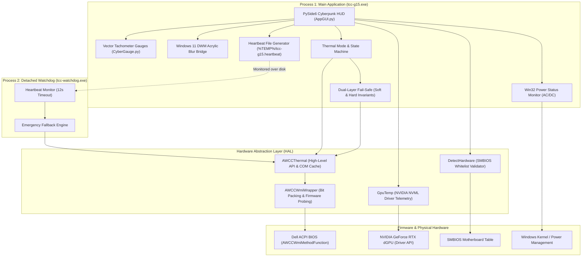

# TCC-G15 System Architecture & Runtime Map

**Version:** 1.8.0-arch-rev1  
**Status:** Approved for Cycle 001  
**Author:** Architect Role (hat)  
**Last Audited:** 2026-11-04  

---

## 1. System Overview

Thermal Control Center (TCC-G15) is an autonomous, low-overhead hardware thermal control and telemetry utility targeting Dell G-Series and Alienware laptops under Windows 10/11. The application replaces proprietary vendor background services (Dell Alienware Command Center / AWCC) by communicating directly with Dell's ACPI/WMI thermal firmware tables (`root\WMI:AWCCWmiMethodFunction`) and reading hardware GPU temperatures via the NVIDIA NVML driver API.

---

## 2. Runtime Processes & Lifecycle

### 2.1 Process 1: Main Application (`tcc-g15.py` / `tcc-g15.exe`)
- **Elevation:** Elevated (Administrator token enforced via UAC manifest `requireAdministrator`). Necessary to access `root\WMI`.
- **Primary Thread:** PySide6 Qt GUI event loop (`QApplication.exec()`).
- **Periodic Timer (`QPeriodic`):**
  - **Visible:** Polled every 2,000 ms (`TEMP_UPD_PERIOD_MS`).
  - **Hidden / Minimized:** Polled every 5,000 ms (`TEMP_UPD_PERIOD_MS_HIDDEN`).
  - **Actions on tick:**
    1. Touch heartbeat file (`%TEMP%\tcc-g15.heartbeat`).
    2. Query NVIDIA NVML GPU temp (fallback to WMI Sensor 6).
    3. Query Dell WMI CPU temp.
    4. Query Dell WMI fan RPMs.
    5. Query Win32 power status (`GetSystemPowerStatus`). Transition to `Quiet` if DC; restore if AC.
    6. Evaluate soft fail-safe (CPU ≥ 95°C / GPU ≥ 85°C for > 8s).
    7. Evaluate **hard fail-safe invariant** (CPU ≥ 100°C / GPU ≥ 90°C for > 4s, independent of user toggle).
    8. Repaint vector gauges (`CyberGauge.update()`).

### 2.2 Process 2: Detached Watchdog (`tcc-watchdog.py` / `tcc-watchdog.exe`)
- **Process Isolation:** Spawned detached by main application via `subprocess.Popen(..., close_fds=True)` or WMI `Win32_Process.Create`.
- **Footprint:** Headless Python / PyInstaller binary, ~4 MB working set.
- **Heartbeat Contract:**
  - Watchdog checks `mtime` of `%TEMP%\tcc-g15.heartbeat` every 2.0s.
  - If heartbeat age > 12.0s (indicating main application hung, crashed, or was terminated):
    - Directly instantiates `AWCCThermal`.
    - Forces firmware into **Balanced** mode (`0xA0`).
    - Writes breadcrumb marker (`%TEMP%\tcc-g15.heartbeat.restored`).
    - Cleanly exits with code 0.

---

## 3. Hardware Call-Sites Inventory

| File | Line(s) | Target Hardware / Subsystem | Call Signature / Method | Purpose / Invariants |
|---|---|---|---|---|
| `src/Backend/AWCCThermal.py` | 14–16 | Win32 COM Cache | `shutil.rmtree(%TEMP%\gen_py)` | Prevents corrupt typelib after AWCC uninstall |
| `src/Backend/AWCCThermal.py` | 38 | Dell ACPI WMI Table | `WMI(namespace='root/WMI')` | Connects to Dell AWCC WMI namespace |
| `src/Backend/AWCCWmiWrapper.py` | 31, 36, 41 | Dell BIOS Thermal Sensors | `Thermal_Information(arg)` | Reads sensor temps and fan RPMs |
| `src/Backend/AWCCWmiWrapper.py` | 84, 88 | Dell EC Fan Speeds | `Thermal_Control(packedArg)` | Writes manual fan speed offset (0–100%) |
| `src/Backend/AWCCWmiWrapper.py` | 108 | Dell BIOS USTT Profiles | `Thermal_Control(modeCode)` | Switches thermal profile (0xA0, 0xA1, 0xA3, 0xAB, 0x0) |
| `src/Backend/DetectHardware.py` | 28 | SMBIOS ComputerSystem | `Win32_ComputerSystem()[0]` | Validates manufacturer and model against whitelist |
| `src/Backend/DetectHardware.py` | 46, 50 | Hardware Component Names | `Win32_Processor`, `Win32_VideoController` | Queries CPU and dGPU hardware marketing strings |
| `src/Backend/GpuTemp.py` | 15–18 | NVIDIA Display Driver | `nvmlInit()`, `nvmlDeviceGetHandleByIndex(0)` | Direct driver initialization |
| `src/Backend/GpuTemp.py` | 30 | NVIDIA GPU Hardware Sensor | `nvmlDeviceGetTemperature(...)` | Accurate sub-degree GPU core temperature |
| `src/GUI/AppGUI.py` | 44 | Windows DWM (Desktop Window Manager) | `DwmSetWindowAttribute(hwnd, 38, ...)` | True Windows 11 DWM Acrylic backdrop |
| `src/GUI/AppGUI.py` | 58 | Windows Kernel Power Management | `kernel32.GetSystemPowerStatus(...)` | Real-time AC vs Battery line status |
| `src/tcc-watchdog.py` | 47 | Dell ACPI Thermal Fallback | `awcc.setMode(ThermalMode.Balanced)` | Restores firmware Balanced mode on heartbeat death |

---

## 4. State Machines

### 4.1 Thermal Mode Transitions
Modes: `Balanced` (0xA0), `Performance` (0xA1), `Quiet` (0xA3), `G_Mode` (0xAB), `Custom` (0x00).
- USTT models (G15 5530) require 0xA0/0xA1/0xA3.
- Legacy models fallback to 0x97/0x98/0x96.
- Switching to `Custom` activates manual fan speed slider offsets (clamped 0–100%).
- `G_Mode` overrides EC acoustic floor to maximum RPM (~5400–5500 RPM).
- On battery detection, current profile is saved as `_acPreferredMode` and app switches to `Quiet`.
- When AC is plugged back in, `_acPreferredMode` is automatically restored.

### 4.2 Fail-Safe State Machine
- **Soft Fail-Safe:** Active if `_failsafeOn == True`. Triggers if CPU ≥ 95°C or GPU ≥ 85°C continuously for > 8s. Switches to `G_Mode`.
- **Hard Fail-Safe (INV-1):** Active **always** (cannot be disabled by UI toggle). Triggers if CPU ≥ 100°C or GPU ≥ 90°C continuously for > 4s. Switches to `G_Mode`.
- **Recovery:** When temperatures stay below soft thresholds for 60 continuous seconds, mode reverts to user's previous selection.

---

## 5. Technical Debt & Forensic Audit Summary

1. **CI Trigger Mismatch (DEF-001 / P0):** `.github/workflows/ci.yml` targeted `master` and `g15-5530`, while default branch is `main`. CI was never executing.
2. **Hardware Whitelist Inconsistency (DEF-002 / P0):** README listed `G16 7630` and `m15 R7` as compatible, but `DetectHardware.py` lacked them in `SUPPORTED_MODELS`.
3. **Missing INV-1 Invariant Test (DEF-003 / P0):** No automated test validated that the hard fail-safe triggers when `_failsafeOn == False`.
4. **Tracked Debug Artifacts (DEF-004 / P1):** 44 temporary files (`docs/baseline/*.log`, `docs/restorepoint.txt`, `docs/restorestatus.txt`) tracked in git.
5. **Unpinned Dependencies (DEF-005 / P1):** `requirements.txt` used loose `>=` bounds and mixed test/dev dependencies into runtime requirements.

---

## 6. Document Consistency Report
- `README.md` claims reconciled against `src/Backend/DetectHardware.py` and `CLAIMS.md`.
- `CHANGELOG.md` audited; accurate up to v1.8.0.
- `docs/BASELINE.md` verified against physical machine run logs.
